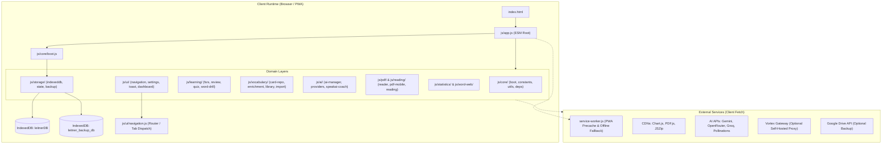

# Architecture & System Design — Leitner Pro Max

## System Architecture Overview
Leitner Pro Max is engineered as a modern, client-side, offline-first Single Page Application (SPA). The architecture eliminates server dependencies by leveraging browser-native primitives (IndexedDB, Web Crypto, Web Workers/Service Workers, Canvas, Speech Synthesis) while structuring JavaScript logic into 10 decoupled ES6 domains.

## Architectural Boundaries & Principles

### 1. Module Decoupling with Window Compatibility
The codebase underwent a phased migration from a 9,300-line monolithic script (`legacy-main.js`) into modular ES6 modules organized across 10 functional domains.
- Internal module communication uses standard ES `import` / `export`.
- `js/app.js` exposes core APIs and symbols onto `window` to maintain seamless backwards compatibility with inline HTML event listeners (`onclick="renderLibrary()"`), dynamic UI templates, and legacy event triggers.
- Global `window.S` acts as the active reactive state object, managed through `js/storage/state.js`.

### 2. State & Persistence Architecture
- **Source of Truth**: Browser `IndexedDB` (`leitnerDB`, store `data`) holds the unified application state:
  - `S.words`: Active Leitner flashcard deck.
  - `S.longTerm`: Mastered cards transferred to long-term memory.
  - `S.stats`: Aggregate metrics, XP, streak, and daily history.
  - `S.quizStats`: Session histories, word performance ratings, and error logs.
  - `S.settings`: Visual theme, review limits, audio preferences, and API configuration.
- **Save Strategy**: State changes invoke `save()`, which debounces writes to `idbPut('state', window.S)` to ensure high UI responsiveness while preventing write bottlenecks.
- **Card Repository Pattern**: `js/vocabulary/card-repository.js` maintains an in-memory `Map` of normalized words for instant $O(1)$ duplicate checking and lookup across both `words` and `longTerm` lists without linear scanning.
- **Lookup Cache Store**: Translation, dictionary, and etymology responses are cached directly in IndexedDB under `app_cache_*` keys with configurable TTL to avoid redundant network calls and enable offline vocabulary browsing.

### 3. Spaced Repetition Engine (FSRS-5)
The application utilizes the state-of-the-art **Free Spaced Repetition Scheduler (FSRS-5)** in `js/learning/fsrs.js`:
- Uses the 17-parameter weight model (`FSRS_W`) to calculate card retrievability $R(t, S)$, initial difficulty $D_0(G)$, initial stability $S_0(G)$, and post-review stability $S'(D, S, R, G)$.
- Four discrete grading options: `1=Again`, `2=Hard`, `3=Good`, `4=Easy`.
- Implements interval fuzzing (`fuzzInterval`) with $\pm 5\%$ variation to prevent review clustering on identical dates.
- Preserves backwards compatibility with legacy SM-2 card records (`sm2Legacy`), smoothly converting them on first interaction.

### 4. Artificial Intelligence Subsystem
- **Provider Architecture**: `js/ai/providers.js` and `js/ai/ai-manager.js` abstract interactions with multiple LLM backends:
  - **Google Gemini**: Modern endpoint integration supporting Gemini 3.8 Flash, 3.7 Flash, 3.5, and 2.5 series, vision input, and automatic key rotation across multiple configured API keys.
  - **OpenRouter**: Access to open-weight models (Llama 3.3, DeepSeek R1, Qwen 2.5, Gemma) with free-tier support.
  - **Groq**: Ultra-low-latency LPU inference.
  - **Pollinations AI**: Zero-configuration, keyless public endpoint for immediate use.
- **Vortex Gateway**: A lightweight, self-hostable VLESS/WebSocket proxy (`vortex/`) specifically hardened for CORS compliance and Bearer token authentication, allowing users in geo-restricted regions to access Gemini and external AI endpoints seamlessly.
- **SpeakAI Coach Bridge**: Embedded interactive voice assistant (`js/ai/speakai-coach.js`). Communicates with the embedded SpeakAI Coach application (`speakai/index.html` or online GitHub Pages) using bidirectional `window.postMessage`, allowing one-click transfer of vocabulary identified during spoken conversation directly into the Leitner deck.

### 5. Document & Reading Engine
- **Desktop PDF Reader (`js/pdf/reader.js`)**: Loads and renders PDF documents with PDF.js on HTML5 canvas elements alongside an overlay text layer, enabling native text selection, word highlighting, and on-the-fly dictionary lookup.
- **Mobile PDF Reader (`js/pdf/pdf-mobile.js`)**: Streamlined mobile touch interface for phone screens.
- **VocabForge Engine (`js/ui/help-vocabforge.js`)**: High-performance document vocabulary extractor. Accepts raw text, TXT, DOCX, and PDF text, parses word frequencies against CEFR tiers (`data/cefr.json`), auto-enriches entries with definitions, phonetics, and Persian translations, and batches imports into the card repository.

### 6. PWA & Offline Strategy
- Service Worker (`service-worker.js`) utilizes a **Cache-First** strategy for all static assets and application modules listed in `PRECACHE_URLS`.
- Cross-origin API calls (dictionaries, translations, AI providers) follow a **Network-First** strategy.
- Cache versioning (`CACHE_NAME = 'leitner-pro-max-v5.0.0'`) ensures instant cache invalidation upon deploying app updates, prompting users via an interactive update banner (`leitner:updated` custom event).
